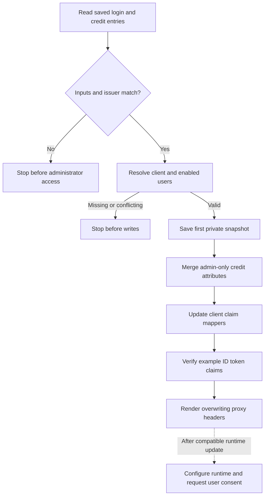

# Team login credit claims

## Overview

An operator stages Git credit details in an existing team's Keycloak realm and
OAuth2 Proxy configuration. The flow ends at signed claims and rendered proxy
headers. Enabling credit in an OpenClaw runtime and obtaining each person's
consent are separate steps after a compatible runtime update.

## Entry Points

- Trigger: run `deploy/rhoai/scripts/configure-team-login-credit`, then
  `deploy/rhoai/scripts/prepare-team-login` with the saved login directory.
- Source: `deploy/rhoai/scripts/configure-team-login-credit:1` and
  `deploy/rhoai/scripts/prepare-team-login:1`.
- Assumptions: existing realm, client, enabled users and saved immutable subject
  mappings; explicit Keycloak administrator access through `KUBECONFIG`; private
  credit input file outside the checkout. The operator verifies email ownership.

## Flow

## Execution Trace

### 1. Validate inputs and resolve existing accounts

`deploy/rhoai/scripts/configure-team-login-credit:1` reads the private credit map.
Every entry names a saved teammate and supplies single-line name/email values
and a boolean verification assertion. The helper checks the saved issuer before
loading the realm helper's administrator authentication. It refuses `master`.

The Keycloak API resolves one client and each saved subject. Disabled accounts,
username mismatches and conflicting claim mappers stop the operation before
writes. No user, password or membership is created.

### 2. Save recovery state and merge credit attributes

`deploy/rhoai/scripts/configure-team-login-credit:api` retrieves the realm profile,
selected users and client mappers. It saves the first private snapshot per client
and preserves that snapshot on retries. This is recovery input, not an automatic
rollback. A request failure can leave partial changes; inspect before retrying.

Each claim's user attribute includes a hash of the client ID. Profile permissions
allow only administrators to view or edit those attributes. User updates preserve
other account fields and attributes, including another client's scope cap.
`emailVerified` records the operator's assertion; it does not verify an address
or alter the account's built-in email properties.

### 3. Emit and verify client-specific claims

`deploy/rhoai/scripts/configure-team-login-credit:api` creates or updates three
user-attribute mappers on the selected client. String claims named
`oce_git_coauthor_name`, `oce_git_coauthor_email` and
`oce_git_coauthor_email_verified` appear in ID/access tokens and userinfo.
Verification is the string `true` or `false`. Keycloak's example ID token must
match each supplied entry before the helper reports success. Omitted users keep
previous details; an explicit false assertion withdraws verification.

### 4. Render proxy headers and defer runtime activation

`deploy/rhoai/scripts/prepare-team-login:1` adds the three claims to
`additionalClaims` and overwrites the corresponding `X-Coauthor-*` headers.
The existing subject-based identity, preferred-username login claim, membership
filter and scope cap remain unchanged. HTTP and WebSocket requests use the same
proxy upstream. Missing optional claims do not prevent sign-in. Existing sessions
need fresh authentication to obtain new claims.

The renderer writes manifests but applies nothing. It adds no `gitCoauthor`
setting to the Gateway Configuration, because the pinned runtime does not
recognize it. The operator applies proxy manifests separately. A compatible
OpenClaw runtime later owns credit import, consent and commit trailers. These
claims do not create linked login email aliases.

## Debugging and Verification

- Run `python3 -m unittest discover -s deploy/rhoai/tests -v` for offline rendering
  and input validation. This does not prove Keycloak or a deployment.
- The RHOAI workflow runs `deploy/rhoai/tests/prove_team_login_credit.py` against
  disposable HTTPS Keycloak. It exercises the supported realm/render/scope/credit
  helpers, real authorization-code/PKCE logins and authenticated userinfo. It checks
  claims, repeated updates, absent users, preserved account
  identity/credentials/scope grants and the recovery snapshot. Only Kubernetes
  Secret/service discovery is substituted. The uniquely named realm is removed.
- That proof stops before an OAuth2 Proxy browser login, OpenShift rollout,
  runtime credit consent or Git commit. Verify those on the selected deployment
  and a disposable repository after the runtime update.
- Inspect the private snapshot and `last-http-error-private.txt` after a Keycloak
  failure. Do not publish those files or recreate the realm to recover.

## Related docs

- [Team login and staged activation](../../deploy/rhoai/TEAM-CREDIT.md)
- [Deployment helpers](../../deploy/rhoai/SCRIPTS.md)

## Manual Notes

[keep this for the user to add notes. do not change between edits]

## Changelog

- 2026-11-12 14:00: Documented staged credit claims and deferred runtime activation with the accompanying helper changes. (authoring-run/718b6c85-d473-4143-b14b-7700e12fd846 - 5f498c7ec416e3a1d3b012f8644204edb13b477e)
